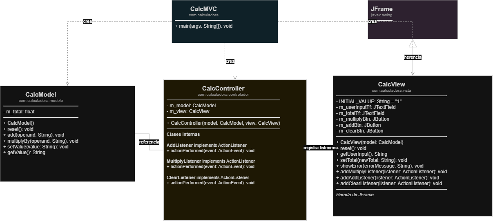

# Calculadora MVC

Calculadora visual sencilla en Java Swing, basada en el ejemplo `Simple Calc - MVC` de la diapositiva. Suma o multiplica el total actual por el número ingresado y permite trabajar con números decimales (`float`).

## Estructura

- `com.calculadora.modelo`: `CalcModel` guarda el total y realiza la suma y la multiplicación.
- `com.calculadora.vista`: `CalcView` muestra la interfaz con los campos Input y Total, y los botones Multiply, Add y Clear.
- `com.calculadora.controlador`: `CalcController` conecta los eventos de la vista con el modelo.

El total inicia en `1`. **Add** suma el número ingresado al total actual; **Multiply** lo multiplica. **Clear** reinicia el total a `1`. Para ingresar decimales, usa punto (por ejemplo, `2.5`).

## Diagrama de clases

El diagrama de clases del proyecto está en [`docs/diagramaDeClases.png`](docs/DiagramaDeClases.png).



## Video de evidencia

[Ver video de evidencia](https://drive.google.com/file/d/1kThpD3iCqryFf9OCWcB3kCihgyOj-7NU/view?usp=sharing)

## Compilar y ejecutar en PowerShell

```powershell
New-Item -ItemType Directory -Force out
javac -d out (Get-ChildItem -Recurse -Filter *.java src\main\java | ForEach-Object FullName)
java -cp out com.calculadora.CalcMVC
```
